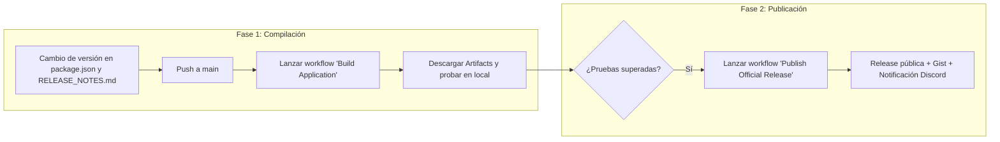
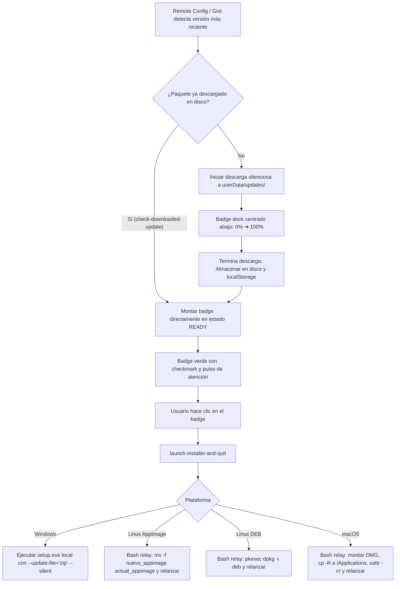

# Guía de Compilación, CI/CD y Publicación - HelloWorld Launcher

HelloWorld Launcher utiliza un flujo de trabajo profesional en dos fases en GitHub Actions para compilar binarios multi-plataforma (Windows, Linux y macOS), preservar la reputación del instalador y publicar releases con anuncios automáticos.

---

## 1. El Flujo de Trabajo en Dos Fases



---

## 2. Criterios de Versionado Semántico (MAJOR.MINOR.PATCH)

HelloWorld Launcher sigue rigurosamente SemVer (`X.Y.Z`):

* **`MAJOR` (`X.0.0`) — Muy infrecuente**:
  - Cambia poquísimo y solo ante cambios arquitectónicos masivos o rupturas profundas de compatibilidad.
  - *Ejemplos*: Migración de Firebase a un backend propio dedicado, rediseño completo del motor o arquitectura del launcher, cambio integral de sistemas de autenticación o ruptura total de protocolos con clientes anteriores.
* **`MINOR` (`x.Y.0`) — Incremento estándar de desarrollo**:
  - Es el incremento habitual en el ciclo de vida continuo del proyecto.
  - *Ejemplos*: Nuevas características visibles para el usuario (ej. selector visual de memoria RAM en instalaciones), nuevas opciones de configuración (ej. auto-maximizar al cerrar juego), integración de Jump Lists en la barra de tareas de Windows, o nuevas integraciones con Modrinth.
* **`PATCH` (`x.y.Z`) — Mantenimiento y corrección de bugs**:
  - Reservado casi exclusivamente para parcheo de bugs, hotfixes de emergencia, ajustes cosméticos menores o solución a fallos en librerías/dependencias sin añadir funcionalidades nuevas.
  - *Ejemplos*: Corrección de bloqueo CSP en un iframe, arreglos en la visualización de iconos de modpacks, ajustes de espaciado en CSS o resolución de fallos de timeout.

---

## 3. Estrategia de Reputación SmartScreen (Windows)

> [!IMPORTANT]
> **Preservación del Instalador Bootstrapper:**
> El instalador de Windows (`HelloWorld-Launcher-Setup.exe` ubicado en `installer/`) es un instalador ligero independiente.
> - Al compilar una nueva versión menor o parche del launcher, el workflow `build.yml` **reutiliza el mismo `HelloWorld-Launcher-Setup.exe` de la release anterior**.
> - Esto mantiene el mismo hash SHA-256 del ejecutable de instalación, acumulando descargas y evitando la pantalla azul de advertencia de **Microsoft Defender SmartScreen**.
> - El setup descarga dinámicamente `helloworld-launcher-win.zip` (que sí se actualiza y recompila en cada release).
> - Si se necesita modificar la interfaz o el código del propio instalador, se activa el parámetro `build_setup: true` en el workflow `Build Application`.

---

## 4. Scripts de npm y Regla de Hooks de Precompilación

En `package.json`, Electron-Builder requiere que la interfaz web de Vite esté compilada previamente en `app/ui/dist`:

```json
"scripts": {
  "dev:ui": "vite",
  "build:ui": "vite build",
  "prebuild": "npm run build:ui",
  "build": "electron-builder",
  "prebuild:win": "npm run build:ui",
  "build:win": "electron-builder --win -p never --config.win.target=zip",
  "prebuild:linux": "npm run build:ui",
  "build:linux": "electron-builder --linux -p never",
  "prebuild:mac": "npm run build:ui",
  "build:mac": "electron-builder --mac -p never"
}
```

> [!NOTE]
> En npm, los hooks `pre` requieren coincidencia exacta del nombre del script.
> Ejecutar `npm run build:win` llama a **`prebuild:win`**, no a `prebuild`. Por ello, existen `prebuild:win`, `prebuild:linux` y `prebuild:mac` para asegurar que `npm run build:ui` siempre se ejecute antes de empaquetar con Electron.

---

## 5. Checklist para Publicar una Nueva Versión

Sigue estos pasos rigurosos cada vez que vayas a liberar una actualización:

### 1. Sincronización Local
- [ ] Actualiza la versión en `package.json` (ejemplo: `"version": "2.2.2"`).
- [ ] Redacta las notas en `RELEASE_NOTES.md` bajo el encabezado `# RELEASE <version>`.
- [ ] Si es necesario, verifica que `MODRINTH_USER_AGENT` en `app/src/handlers/mods.js` lea la versión actualizada.
- [ ] Comprueba que no hay errores de TypeScript ejecutando:
  ```powershell
  npx tsc --noEmit
  npm run build:ui
  ```
- [ ] Haz commit y push a la rama `main`:
  ```bash
  git add package.json RELEASE_NOTES.md
  git commit -m "Prepare v2.2.2 release"
  git push origin main
  ```

### 2. Compilación en la Nube
- [ ] Ve a GitHub ➔ Pestaña **Actions**.
- [ ] Selecciona el workflow **Build Application (Artifacts)**.
- [ ] Pulsa **Run workflow** (marcando Windows, Linux y macOS).
- [ ] Espera a que finalice y descarga los artefactos empaquetados (`windows-artifacts`, etc.) para verificar el funcionamiento.

### 3. Publicación Oficial
- [ ] En **Actions**, selecciona el workflow **Publish Official Release**.
- [ ] Pulsa **Run workflow**. El script automáticamente:
  - Creará el tag Git y la Release oficial en GitHub.
  - Subirá todos los binarios empaquetados.
  - Actualizará el Gist remoto de metadatos de actualización.
  - Enviará un anuncio formateado con el changelog al canal de Discord `#updates`.

---

## 6. Formatos de Distribución Multiplataforma

HelloWorld Launcher se empaqueta en formatos optimizados para cada sistema operativo para garantizar la mejor experiencia de instalación y actualización:

| Sistema Operativo | Formato de Archivo | Finalidad y Beneficios |
| :--- | :--- | :--- |
| **Windows** | `helloworld-launcher-win.zip` | Paquete portable principal con todos los binarios y recursos. El instalador `setup.exe` lo descomprime directamente en la carpeta de instalación. |
| **Windows** | `HelloWorld-Launcher-Setup.exe` | Instalador bootstrapper ligero (`installer/`). Se mantiene con el mismo binario a lo largo de versiones menores para acumular reputación en SmartScreen. Se copia como `setup.exe` en el directorio de la aplicación. |
| **Linux** | `helloworld-launcher-linux-${arch}.AppImage` | **Formato universal portable sin permisos de root ("Zero-Root").** Funciona en cualquier distro (Ubuntu, Debian, Fedora, Arch, Manjaro, openSUSE) y en **SteamOS (Steam Deck)**. Permite actualizaciones atómicas en caliente sin pedir contraseña de administrador (`sudo`). |
| **Linux** | `helloworld-launcher-linux-${arch}.deb` | Paquete nativo para distribuciones basadas en Debian/Ubuntu. Se instala en el sistema (`/opt/HelloWorld-Launcher`). Al actualizar, utiliza elevación nativa gráfica `pkexec` en lugar de los centros de software lentos o inestables. |
| **macOS** | `helloworld-launcher-mac-${arch}.dmg` | Imagen de disco estándar. El relay de actualización lo monta de forma silenciosa, sobrescribe `/Applications/HelloWorld-Launcher.app`, limpia la cuarentena de Gatekeeper con `xattr -cr` y relanza la app sin fricción. |

### ¿Por qué mantener tanto `.AppImage` como `.deb` en Linux?
1. **`.AppImage` resuelve la fragmentación de distros:** Los usuarios de Arch Linux, Fedora o Steam Deck no pueden instalar un archivo `.deb`. AppImage les permite jugar sin dependencias externas.
2. **Cero contraseñas con AppImage:** El usuario descarga el AppImage en cualquier carpeta de usuario (`~/Applications`) y el launcher se actualiza solo en 200 ms reemplazando el archivo con `mv -f`.
3. **`.deb` para integración de sistema:** Los usuarios puristas de Ubuntu/Debian que prefieren su gestor de paquetes de sistema conservan el paquete `.deb`.
4. **Detección Automática en Tiempo de Ejecución:** El launcher consulta `process.env.APPIMAGE`. Si el usuario está ejecutando desde un AppImage, descarga automáticamente el `.AppImage`; si se ejecuta desde una instalación de sistema, descarga el `.deb`.

---

## 7. Arquitectura del Sistema de Actualizaciones Silenciosas (Background Updater)

El launcher incorpora un sistema de actualización en segundo plano no invasivo inspirado en navegadores modernos:



### Características Clave:
1. **Sin descargas repetidas:**
   El paquete se descarga en la carpeta protegida de la app (`app.getPath('userData')/updates/`). Cuando `setup.exe` arranca en Windows, recibe el argumento `--update-file="<ruta_del_zip>"`, por lo que **no vuelve a descargar nada de GitHub**, sino que extrae directamente el archivo ya descargado.
2. **Reutilización inteligente de `setup.exe`:**
   El launcher busca `setup.exe` en su propia carpeta de ejecución (`execDir`). Compara el hash SHA-512/SHA-256 del setup local contra el esperado remotamente. Si coinciden, reutiliza el `setup.exe` local. Si difieren (nueva versión mayor del instalador), descarga el setup nuevo.
3. **Persistencia del estado "Listo":**
   El IPC `check-downloaded-update` y `localStorage` guardan la ruta y versión descargada. Si el usuario cierra el launcher y lo vuelve a abrir antes de reiniciar para aplicar, el badge se monta inmediatamente en verde (100% listo) sin volver a iniciar la descarga desde cero.
4. **Badge Dock Centrado:**
   Componente `<UpdateBadge />` con CSS glassmorphism posicionado en `bottom: 24px; left: 50%; transform: translateX(-50%)`, aro SVG interactivo y pulso de atención que alerta al usuario cuando la versión está lista para aplicar en un clic.
5. **Modo de Prueba para Desarrolladores:**
   En **Ajustes ➔ Modo Desarrollador**, el botón *"Probar flujo de actualización"* invoca `triggerTestUpdateFlow()`, que genera un paquete zip local válido mediante `prepare-test-update-file`, simula la progresión visual del 0 al 100% y permite probar la ejecución desatendida del setup en caliente.

