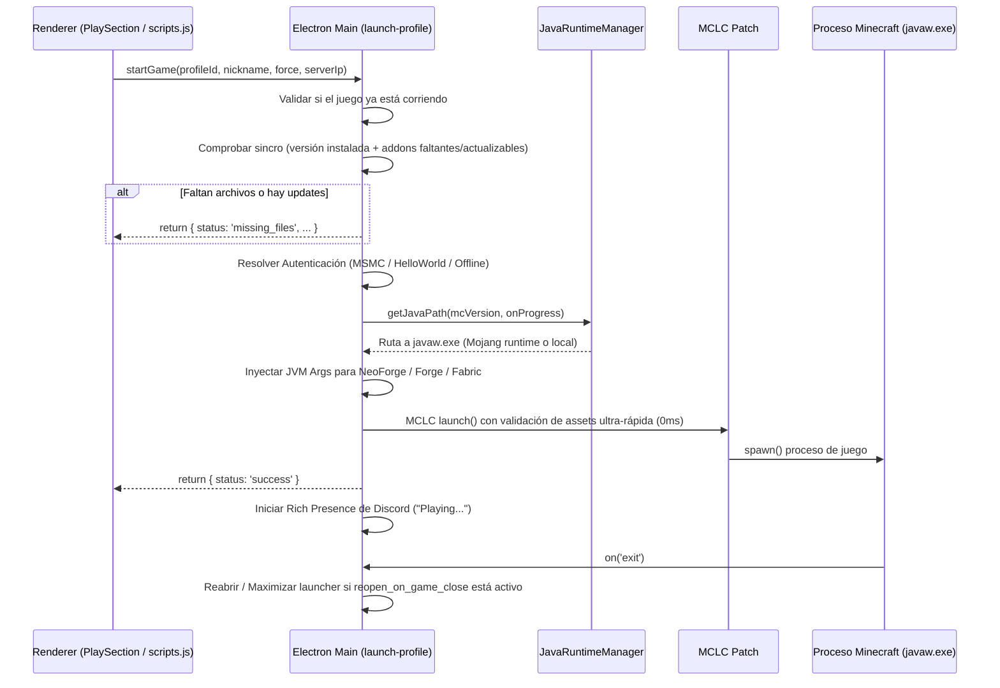

# Motor de Lanzamiento de Minecraft - HelloWorld Launcher

Este documento detalla el ciclo completo de preparación, validación, inyección y ejecución de Minecraft dentro de HelloWorld Launcher.

---

## 1. El Flujo de `launch-profile` (`app/main.js`)

Cuando el usuario pulsa **Play** (o se dispara un inicio rápido desde la JumpList/acceso directo):

---

## 2. Parche de Rendimiento Crítico: `mclcPatch.js`

El launcher utiliza `minecraft-launcher-core` (MCLC), pero con un parche personalizado de alto rendimiento (`app/src/utils/mclcPatch.js`) que soluciona tres problemas graves:

1. **Fin al congelamiento de la interfaz**:
   - Por defecto, MCLC calcula el hash SHA-1 de más de 5,000 archivos en cada lanzamiento, bloqueando el hilo de eventos de Node.js durante 3.5 segundos.
   - **Solución del Parche**: Crea un archivo marcador `<assetId>.verified` en `<mcDir>/assets/indexes/`. En posteriores lanzamientos, comprueba la existencia del marcador y omite la verificación completa en **0 ms**.
   - Si la verificación completa es necesaria, procesa los assets en lotes de 64 (`BATCH_SIZE = 64`) cediendo el control al bucle de eventos con `setImmediate`, manteniendo el bombeo de mensajes de Windows fluido.
2. **Cancelación inmediata**:
   - Permite abortar el lanzamiento en cualquier instante mediante `this._cancelled = true`, saliendo de los bucles de assets y librerías sin dejar tareas huérfanas en segundo plano.
3. **Manejo de Assets Legacy**:
   - Si la versión es antigua (`isLegacy()`), copia los assets a la carpeta `resources` de manera no bloqueante.

---

## 3. Gestor Automático de Java: `javaRuntime.js`

Cada versión moderna o histórica de Minecraft requiere una versión específica de Java (Java 8, Java 16, Java 17, Java 21, etc.).

1. **Detección del componente de Mojang**:
   - Consulta el manifiesto oficial de versiones de Mojang (`https://piston-meta.mojang.com/mc/game/version_manifest_v2.json`).
   - Lee el campo `javaVersion.component` (por ejemplo: `java-runtime-gamma` para Java 17, `java-runtime-delta` para Java 21).
2. **Caché en dos niveles**:
   - Nivel en memoria: mapa rápido en memoria con resolución `< 0.1 ms`.
   - Nivel en disco: `<mcDir>/java-runtimes/manifest_cache.json`.
3. **Descarga y Extracción**:
   - Si no está presente, descarga los binarios oficiales de Mojang en lotes de 10 archivos concurrentes hacia `<mcDir>/java-runtimes/<component>/`.
   - En Linux y macOS, aplica permisos ejecutables (`chmod 0755`) en binarios como `java`, `javaw` y `jspawnhelper`.
4. **Fallback Offline**:
   - Si no hay conexión o falla la descarga, escanea el directorio `<mcDir>/java-runtimes/` buscando cualquier runtime instalado compatible, o recurre al `java` del sistema.

---

## 4. Normalización de Versiones: `version.js`

El launcher soporta la nueva nomenclatura estandarizada:
- `Vanilla <mcVersion>` (ejemplo: `Vanilla 1.21.11`)
- `Fabric <mcVersion> (<loaderVersion>)` (ejemplo: `Fabric 1.21.11 (0.58.2)`)
- `Forge <mcVersion> (<loaderVersion>)` (ejemplo: `Forge 1.20.1 (47.4.10)`)
- `NeoForge <mcVersion> (<loaderVersion>)` (ejemplo: `NeoForge 1.21.1 (21.1.5)`)
- `OptiFine <mcVersion> (<loaderVersion>)`

### Mapeo de Carpetas en `versions/`
La función `getPossibleDirNames(version)` resuelve las distintas formas en las que los instaladores nombran la carpeta física:
- `fabric-loader-<loader>-<mc>`
- `<mc>-forge-<loader>`
- `neoforge-<loader>-<mc>`
- `<mc>-OptiFine_<loader>`

---

## 5. Inyección de Argumentos JVM para Loaders Modernos (NeoForge / Forge)

> [!WARNING]
> MCLC **ignora** la sección `arguments.jvm` dentro de los JSON de versiones personalizadas. En loaders modernos como NeoForge, esto provocaba el error crítico:
> `"The installation is corrupted!"` debido a la falta de variables como `-DlibraryDirectory=${library_directory}`.

### La Solución Implementada en `app/main.js`:
1. El backend lee el archivo JSON de la versión personalizada (`versions/<customVersion>/<customVersion>.json`).
2. Extrae las directivas de `arguments.jvm`.
3. Sustituye dinámicamente las variables de plantilla:
   - `${library_directory}` ➔ Ruta absoluta a `libraries/`.
   - `${classpath_separator}` ➔ `;` en Windows, `:` en Unix.
   - `${game_directory}` ➔ Directorio del perfil de juego.
   - `${assets_root}` ➔ Ruta absoluta a `assets/`.
   - `${auth_uuid}` y `${auth_access_token}` ➔ Credenciales resueltas.
4. Pasa los argumentos procesados en `options.customArgs` a MCLC.

---

## 6. Conexión Directa a Servidores y `servers.dat` (`serversDat.js`)

Cuando el usuario inicia el juego pulsando en un servidor destacado o mediante invitación:
1. Pasa `--server <ip>` y `--port <port>` como parámetros de juego.
2. Inyecta el servidor en `servers.dat` utilizando `prismarine-nbt`:
   - Lee el archivo binario NBT `servers.dat` del perfil.
   - Comprueba si la IP ya existe (case-insensitive).
   - Si no existe, añade el servidor al principio de la lista.
   - Si la conexión directa falla en el cliente de Minecraft (error `Connection reset`), el usuario puede volver a intentarlo cómodamente desde la lista de servidores sin reescribir la IP.

---

## 7. Discord Rich Presence (`rpc.js`)

- **Application ID**: `1464624951578595368`
- **Estados soportados**:
  - `setLauncher()`: En el launcher, estado "Online".
  - `setMenu({ version, profileName, ign })`: En menús principales del juego.
  - `setPlaying({ version, profileName, ign, worldName })`: Jugando en un mundo local (`Playing <Mundo>`).
  - `setServer({ version, profileName, ign, serverIp, privacyMode })`: Jugando en multijugador (`Playing on <IP>` o `Playing Multiplayer` si `privacyMode` está activado).

---

## 8. Auto-Reapertura y Auto-Maximizar (`reopen_on_game_close`)

1. Al spawnear el proceso de Minecraft, se almacena en `activeGameProcesses`.
2. Se registra el manejador `gameProcess.on('exit')` o `on('close')`.
3. Cuando todas las instancias de Minecraft se cierran:
   - Si `reopen_on_game_close` está activado en `user.json` / Settings:
     - `mainWindow.show()`
     - `mainWindow.restore()` (si estaba minimizada)
     - `mainWindow.maximize()`
     - `mainWindow.focus()`
