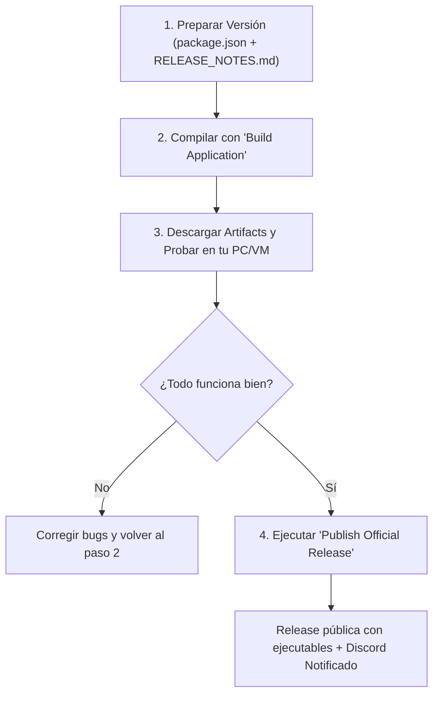

# Guía de Compilación, Test y Publicación con GitHub Actions

Esta guía documenta el **flujo de trabajo profesional en dos fases (Build & Release)** para HelloWorld Launcher. El sistema te permite compilar en la nube para **Windows**, **Linux** y **macOS**, descargar los instaladores para probarlos en tu PC o en otros equipos, y finalmente publicar la Release oficial con su changelog y notificación automática a Discord con solo un clic.

---

## 1. Configuración de Secretos en GitHub (Solo 1 vez)

Para que los ejecutables se compilen con las credenciales de Firebase y webhooks sin exponerlos en el repositorio público:

1. Ve a tu repositorio en GitHub:
   👉 **Settings** ➔ **Secrets and variables** ➔ **Actions**
2. Asegúrate de tener configurados estos **Repository secrets**:

| Nombre del Secreto | Descripción | Valor a pegar |
| :--- | :--- | :--- |
| `APP_SECRETS_JSON` | Contenido completo de tu `secrets.json` local | El JSON con tus credenciales de Firebase, Gist y webhooks |
| `DISCORD_WEBHOOK` | Webhook de Discord para el canal `#updates` | La URL del webhook copiada de tu canal de Discord |

> [!TIP]
> **Seguridad garantizada**: La Action crea el archivo `secrets.json` dentro de la máquina virtual durante la compilación y el entorno se destruye completamente al finalizar. `service-account.json` no se sube a secrets (es solo de uso administrativo local).

---

## 2. El Flujo de Trabajo en 4 Pasos



---

### Paso 1: Preparar la versión y redactar las notas

1. Abre [package.json](file:///package.json) e incrementa el número de versión:
   ```json
   "version": "2.2.0"
   ```
2. Abre [RELEASE_NOTES.md](file:///RELEASE_NOTES.md) y escribe las novedades de esta versión:
   ```markdown
   # RELEASE 2.2.0

   ## Added
   - Featured servers tab.
   - Remote maintenance system.

   ## Fixed
   - Fixed Windows notifications.
   ```
3. Guarda y sube los cambios a tu rama `main`:
   ```bash
   git add package.json RELEASE_NOTES.md
   git commit -m "Prepare v2.2.0 release"
   git push origin main
   ```

---

### Paso 2: Compilar en la nube con "Build Application"

1. Ve a la pestaña **Actions** en tu repositorio de GitHub.
2. En la lista de workflows a la izquierda, selecciona **Build Application (Artifacts)**.
3. Haz clic en el botón desplegable **Run workflow**:
   * Puedes elegir qué plataformas compilar (Windows, Linux, macOS).
   * Haz clic en **Run workflow**.
4. GitHub Actions levantará máquinas virtuales en paralelo y compilará los instaladores.

> [!IMPORTANT]
> **Reputación SmartScreen protegida:**
> El workflow `Build Application` compila el launcher `helloworld-launcher-win.zip` y **reutiliza el mismo `HelloWorld-Launcher-Setup.exe` de la release anterior**.
> Al no recompilar el instalador bootstrapper en cada release menor, se conserva su hash SHA-256 y su reputación acumulada en Microsoft Defender SmartScreen, evitando la pantalla azul a tus nuevos usuarios.

---

### Paso 3: Descargar y Probar los Instaladores

1. Al finalizar la compilación (unos 3-4 minutos), haz clic en la ejecución completada.
2. Abajo del todo verás la sección **Artifacts** con los instaladores empaquetados:
   * 📦 **`windows-artifacts`**:
     - `HelloWorld-Launcher-Setup.exe` (instalador bootstrapper con reputación SmartScreen)
     - `helloworld-launcher-win.zip` (nueva versión de la app)
   * 📦 **`linux-artifacts`**:
     - `helloworld-launcher-linux-amd64.deb` y alias `helloworld-launcher-linux-x64.deb`
     - `helloworld-launcher-linux-arm64.deb` (si se compiló)
   * 📦 **`macos-artifacts`**:
     - `helloworld-launcher-mac-x64.dmg` y `helloworld-launcher-mac-arm64.dmg`
     - `helloworld-launcher-mac-x64.zip` y `helloworld-launcher-mac-arm64.zip`
3. Descarga `windows-artifacts` directamente a tu ordenador y prueba el launcher.

---

### Paso 4: Publicar la Release Oficial y Notificar a Discord

Una vez que has comprobado que los instaladores funcionan correctamente:

1. Ve a la pestaña **Actions** en GitHub.
2. Selecciona el workflow **Publish Official Release**.
3. Haz clic en **Run workflow**:
   * **Release Tag**: Déjalo vacío para usar automáticamente la versión de `package.json` (o escribe `v2.2.0`).
   * **Run ID**: Déjalo vacío para que use automáticamente la última compilación exitosa que acabas de probar.
   * **Publish as Draft?**: Déjalo en `false` para publicación inmediata (o `true` si prefieres revisarla antes).
   * Haz clic en **Run workflow**.

#### ¿Qué ocurre en ese instante?
1. El workflow descarga los archivos verificados de la build (`.exe`, `.deb`, `.dmg`, `.zip`).
2. Si por algún motivo no hubiese un `Setup.exe` nuevo, descarga el de la release anterior para mantener la reputación.
3. Lee tu [RELEASE_NOTES.md](file:///RELEASE_NOTES.md) y lo usa como cuerpo oficial de la Release.
4. Crea la **Release Oficial** en GitHub adjuntando todos los archivos con sus nombres exactos.
5. Al publicarse la release, se dispara automáticamente el workflow **Discord Release Announcement**, enviando una tarjeta visual a tu canal `#updates` con las notas de la versión y el botón directo de descarga.

---

### Paso 5: Actualizar el Gist (`hwlauncher-info.json`)

Para que el nuevo actualizador integrado dentro del launcher muestre la actualización a los usuarios que abren el launcher:

1. Ve a tu [GitHub Gist](https://gist.githubusercontent.com/abeloskyyy/b50089b634ed09f48c921f9c8126a49f/raw/hwlauncher-info.json).
2. Actualiza:
   * `"latestVersion": "2.2.0"`
   * `"minVersion": "2.2.0"` *(si deseas que la actualización sea obligatoria)*
   * En `"changelog.versions"`, añade la nueva entrada con los enlaces a los archivos que acabas de publicar en GitHub Releases y pega el mismo markdown de `RELEASE_NOTES.md`.

---

## 3. ¿Cuándo y cómo recompilar el instalador `Setup.exe`?

Solo debes recompilar el instalador si hiciste cambios en la carpeta [installer/](file:///installer) (cambios en el diseño del instalador, accesos directos, etc.):

1. Ve a **Actions** en GitHub.
2. Selecciona **Rebuild Setup Bootstrapper (Windows Only)**.
3. En **Target Release Tag**:
   * Si pones el tag de una release existente (ej: `v2.2.0`), **sobrescribirá y reemplazará automáticamente** el `HelloWorld-Launcher-Setup.exe` de esa release.
   * Si lo dejas vacío, solo guardará el nuevo instalador como un artefacto descargable para que lo pruebes antes.